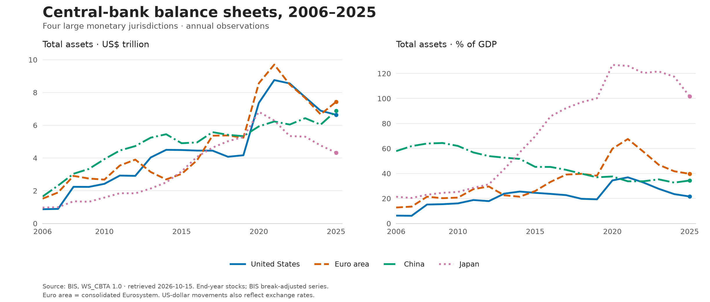
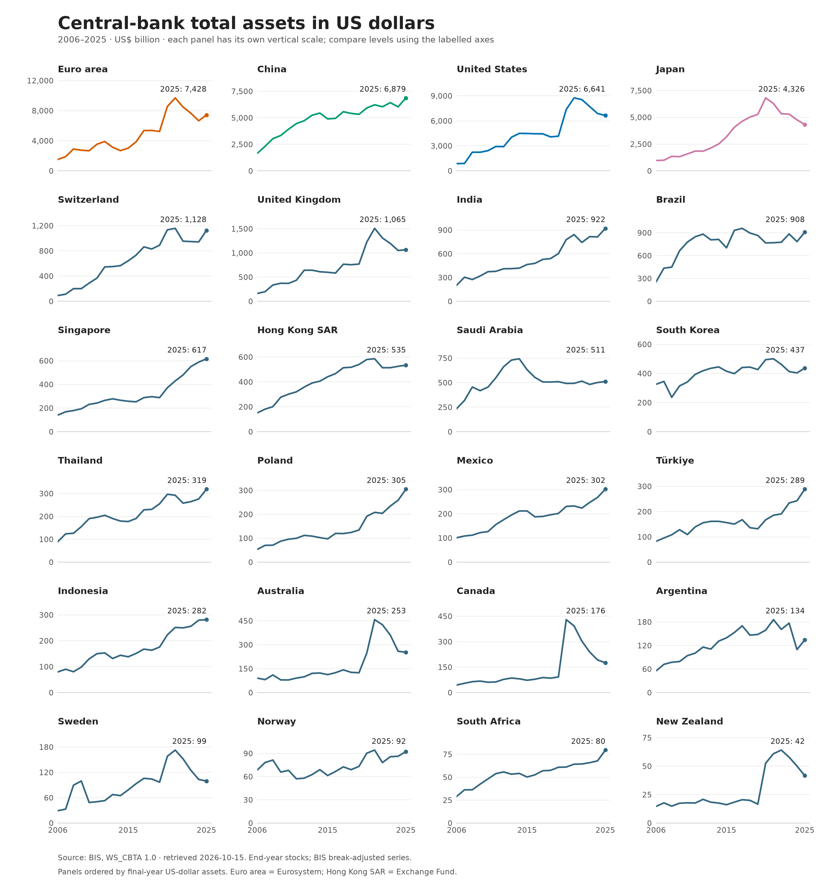
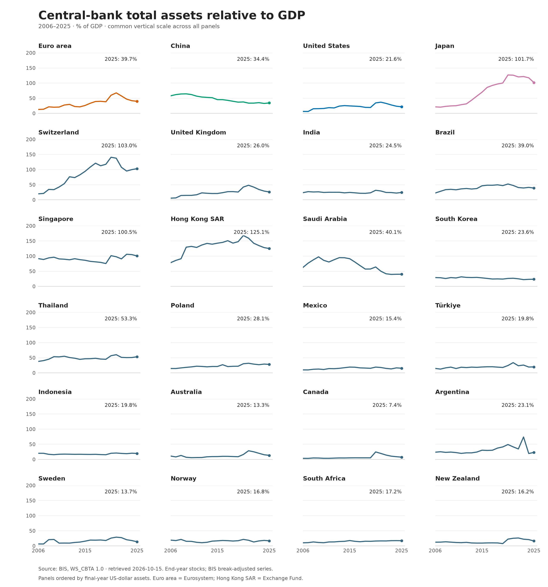

# Central-bank balance sheets since 2006

Annual total assets for 24 selected monetary authorities, retrieved from the
[BIS Central bank total assets dataset](https://data.bis.org/topics/CBTA)
(`BIS,WS_CBTA,1.0`) on **15 October 2026**.

The annual panel covers **2006–2025**, with **480 country-year observations**.
Recent monthly observations are supplied separately, with their individual dates.
They do not represent completed annual observations for 2026. Availability here
means availability in the saved BIS release, which can lag national releases.

## Graphs

The overview compares four large monetary jurisdictions. The full-sample graphs
below cover all 24 authorities. Click a graph to open the full-resolution image.



[Download overview PDF](figures/major_central_banks_overview.pdf)

### All 24 authorities: US-dollar assets

Each panel has its own vertical scale, in US$ billions. Use the labelled axes
and final-year values to compare levels across countries.



[Download US-dollar plots PDF](figures/all_central_banks_usd.pdf)

### All 24 authorities: assets relative to GDP

All panels use the same vertical scale, in percent of GDP.



[Download GDP-share plots PDF](figures/all_central_banks_gdp.pdf)

The comparison series are adjusted for statistical breaks. Euro area means the
consolidated Eurosystem. Dollar changes also reflect exchange-rate movements.

[Download the annual dataset (CSV)](data/processed/annual_balance_sheets.csv)
or [open the executed notebook](central_bank_balance_sheets.ipynb).

## Open and run

Open **`central_bank_balance_sheets.ipynb`**, the entry notebook. It contains the
country mapping, source inspection, transformations, checks, figures and results.
Launch it from this directory and run the cells in order. Settings are in the
first code cell: `START_YEAR`, `COUNTRIES`, `RECENT_MONTHLY_START`, `REFRESH`,
`CORE`, `COLORS` and `STYLES`.

The saved raw snapshot is used by default, so reproduction requires no network
access. The download helper verifies its request parameters and SHA-256 hashes.
Set `REFRESH=True` to fetch a new release; this replaces the saved snapshot.
The notebook deliberately stops on incomplete coverage or unexpected source
attributes so these changes can be reviewed before producing new figures.

Execution used Python 3.14.7 and the package versions in `requirements.txt`.
To reproduce the results, clone this repository, activate a Python environment
with those dependencies, and run:

```sh
cd central-bank-balance-sheets
python run_notebook.py
```

On another machine, use a project-specific environment with the versions in
`requirements.txt`, then run `python run_notebook.py`. A Jupyter notebook editor
can also run the notebook directly. The runner starts a fresh Python kernel and
saves notebook outputs after successful execution.

## Files

- `figures/major_central_banks_overview.*`: US, Eurosystem, China and Japan,
  in US$ trillions and percent of GDP.
- `figures/all_central_banks_usd.*`: all 24 authorities, in US$ billions;
  **vertical scales differ across panels**.
- `figures/all_central_banks_gdp.*`: all 24 authorities, in percent of GDP;
  **a common vertical scale**.
- Every figure is exported as PNG, vector PDF and editable SVG.
- `data/processed/annual_balance_sheets.csv`: the complete annual analysis panel.
- `data/processed/annual_assets_usd_bn_wide.csv` and
  `annual_assets_pct_gdp_wide.csv`: year-by-country tables.
- `data/processed/latest_annual.csv`: final annual observations, ordered by
  US-dollar assets.
- `data/processed/latest_monthly_usd.csv`: latest monthly dollar observation for
  each authority, including its date.
- `data/processed/latest_monthly_by_series.csv`: latest observation in each
  downloaded monthly series, including domestic-currency variants and flags.
- `data/processed/coverage.csv`: country-by-country annual coverage.
- `data/processed/annual_observations.csv` and
  `monthly_recent_observations.csv`: normalized source observations.
- `data/processed/series_metadata.csv`: full series-level BIS compilation notes.
- `data/processed/annual_december_crosscheck.csv` and `validation.json`:
  machine-readable verification results and software versions.
- `data/raw/`: unchanged XML responses, BIS methodology PDF and a manifest of
  exact URLs, retrieval times, content types, byte counts and checksums.
- `bis_data.py`: download and XML parsing helpers; substantive analysis is in
  the notebook.

## Definition and scope

Size means **total assets**, rather than reserves, the monetary base or only
securities held for monetary policy. Annual values are end-of-period stocks,
using December observations where monthly series exist. They are not annual
averages or necessarily the institutions' fiscal-year accounts.

The plotted US-dollar and GDP-ratio series are **BIS-spliced and adjusted for
statistical breaks**. Dollar conversions use market exchange rates; the GDP
denominator is a four-quarter nominal sum. The source also supplies unadjusted
domestic-currency levels, which are retained. No interpolation, GDP estimation,
exchange-rate conversion or seasonal adjustment is performed by this project.

The sample is an explicit selection of major monetary jurisdictions: the G20
central banks available in this dataset, with euro-area members represented once
by the Eurosystem, plus Switzerland, New Zealand, Sweden, Norway, Singapore,
Hong Kong SAR, Thailand and Poland. **Russia is absent from this BIS dataset.**
The sample is not every central bank and must not be described as a world total.

The full list is United States, euro area, Japan, China, United Kingdom,
Switzerland, Canada, Australia, New Zealand, Sweden, Norway, South Korea, India,
Indonesia, Brazil, Mexico, Argentina, South Africa, Türkiye, Saudi Arabia,
Singapore, Hong Kong SAR, Thailand and Poland.

The euro-area series covers the **consolidated Eurosystem**, not the ECB alone.
Hong Kong SAR is the Exchange Fund. Norges Bank excludes the Government Pension
Fund Global. National mandates, asset composition and accounting conventions
still differ; size is not a measure of policy stance or effectiveness. Currency
and valuation movements affect dollar totals; nominal GDP movements affect
GDP ratios. Data are latest revised observations, not historical vintages.

## Annual panel dictionary

| Field | Meaning |
|---|---|
| `country_code`, `country`, `central_bank` | Explicit BIS code and institution mapping |
| `year` | Calendar year of the end-period stock |
| `assets_usd_bn` | Total assets, billions of US dollars, break-adjusted |
| `assets_pct_gdp` | Total assets, percent of GDP, break-adjusted |
| `assets_lcu_bn_adjusted` | Total assets, billions of domestic currency, break-adjusted |
| `assets_lcu_bn_reported` | BIS-spliced domestic-currency levels, billions, without break adjustment |
| `currency` | Domestic currency code |
| `*_series` | Exact BIS series key for the corresponding measure |
| `*_status` | Source observation flag: `A` normal, `B` break |
| `retrieved_utc`, `source` | Snapshot timestamp and dataset identifier |

Series-key dimensions are frequency, geography, compilation method, unit,
currency and transformation. `COMP_METHOD=B` means BIS-spliced;
`TRANSFORMATION=B` means break-adjusted; `TRANSFORMATION=N` means untransformed.
`UNIT_MULT=9` means billions, while GDP percentages use `UNIT_MULT=0`.
For the US, the domestic-currency USD series supplies dollar levels because
there is no separate converted USD series.

## Checks and source citation

The notebook verifies request parameters and raw-file hashes, geography coverage,
end-period collection, units, observation flags, finite positive values,
unique observation keys, one-to-one joins and an uninterrupted annual panel.
It compares final-year levels with the separately requested December monthly
observations and checks representative exported values against the raw XML.
Break flags in the unadjusted UK series (2006, 2013) and Thailand (2018) are
retained; the plotted adjusted observations have normal flags.

Validation on 15 October 2026: all seven code cells executed in a fresh kernel;
all 71 final-year level comparisons matched December exactly, and 15 selected
exported values matched the raw observations. All three PNG figures and all
three rendered vector PDFs were visually inspected for labels, scales and
clipping. The Python helpers compiled and the staged whitespace check passed.
These checks establish internal consistency with the BIS snapshot; they are not
an independent audit of every national central-bank account.

Suggested citation: Bank for International Settlements (2026), *Central bank
total assets*, BIS WS_CBTA 1.0 (data set), https://data.bis.org/topics/CBTA,
accessed 15 October 2026. See the
[BIS methodology](https://www.bis.org/statistics/cbta/cbta_doc.pdf) and
[terms of permitted use](https://data.bis.org/help/legal).
